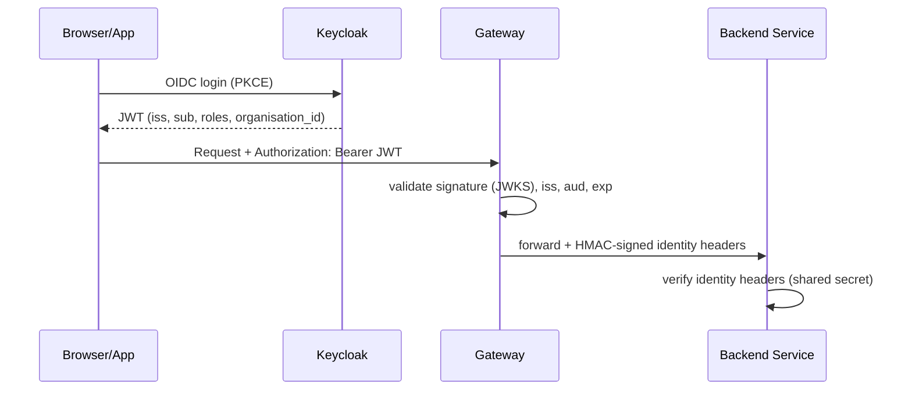

# Authentication Flow

The platform supports two authentication paths, both terminating at the gateway.

## 1. User authentication (JWT via Keycloak)

Key claims the platform uses:

| Claim | Purpose |
| --- | --- |
| `sub` | User UUID (used as `owner_id` / `consumer_id`) |
| `roles` | `consumer`, `provider`, `org_admin`, `cos_admin`, `delegate` |
| `organisation_id` | Org-scoped authorization (org-admin checks) |
| `did` | Delegation: delegator's `sub` when acting on behalf of someone |

## Identity headers (what services actually see)

After validating the token, the gateway **strips** `Authorization` and forwards signed headers:

| Header | Content |
| --- | --- |
| `X-Subject-Id` | User UUID (`sub`) |
| `X-Subject-Email` | Email |
| `X-Subject-Roles` | Comma-separated roles |
| `X-Subject-Org-Id` | Organisation UUID |
| `X-Subject-Issued-At` | Timestamp — bounds replay |
| `X-Subject-Sig` | HMAC-SHA256 over all of the above (shared secret) |

Services verify the signature; an invalid signature is a hard `401` with no fallback.

## 2. Machine authentication (app credentials)

Applications authenticate with `Authorization: Basic base64(appId:appSecret)`. The gateway verifies the credential against the [User Service](../components/user-service.md) and builds the **same identity headers** as the JWT path — internal services cannot tell (and don't care) how a caller authenticated.

## Service-to-service authentication

Internal services calling each other's gRPC interfaces use Keycloak **client-credentials tokens** (service accounts) scoped to the target service; the caller's client ID must be on the target's allowlist.

## See also

- [Error Responses](error-responses.md) — the `401`/`403` contract
- [JWT Validation guide](../guides/jwt-validation.md) — debugging 401s
- [Flow: Authentication & Identity](../flows/authentication.mdx) — the conceptual walkthrough
