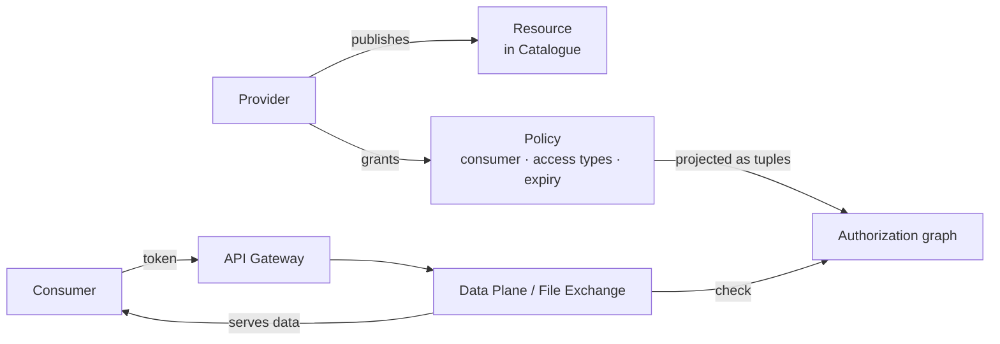

# Core Concepts

Six concepts underpin everything on the Data Exchange. Understand these and every API, flow, and component page will read naturally.

## Resources

A **resource** is anything shareable on the exchange, registered as an item in the [Catalogue](../components/catalogue.md). Every resource has a provider, an owning organisation, descriptive metadata, and a declared set of **access types** it supports.

| Item type | What it is |
| --- | --- |
| `DATABANK` | A dataset — live API-queryable data, downloadable files, or both |
| `AIMODEL` | A trained model published for controlled consumption |
| `APPS` | An application registered on the exchange |

## Actors and roles

Every user carries one or more platform roles in their identity token:

| Role | Powers |
| --- | --- |
| `consumer` | Discover resources, request access, and use granted access |
| `provider` | Publish resources; grant and revoke access to **own** resources |
| `org_admin` | Everything a provider can do, for **all** resources of their organisation |
| `cos_admin` | Platform-wide visibility and administration (operates the exchange) |
| `delegate` | Act on behalf of another user, within an explicitly recorded delegation |

**Organisations** group users and resources. A user's organisation membership travels in their token and in the authorization graph, which is how organisation-wide grants work without per-user bookkeeping.

**Applications (M2M)** are non-human callers holding app credentials (ID + secret). They authenticate at the gateway just like users and can optionally act *on behalf of* a user via a delegation.

## Policies (access grants)

A **policy** is an explicit, auditable record that a consumer may access a resource: *who*, *what resource*, *which access types*, *until when*. Policies are the platform's **source of truth for access** — created and revoked in the [Policy Service](../components/policy-service.md), never implied.

- **Individual policy** — grants one named consumer access to one resource.
- **Group policy** — grants access by criteria: allowed organisations, allowed users, or roles.
- Every policy is **time-bound** (expiry required) and **soft-deleted** on revocation, preserving the audit history.

## Access types

What a grant covers, validated against what the resource actually supports:

| Access type | Meaning | Served by |
| --- | --- | --- |
| `api` | Query the resource's data through APIs | [Data Plane](../components/data-plane.md) |
| `file` | Download the resource's files | [File Exchange](../components/file-exchange.md) |
| `sub` | Subscribe to a live stream of new data | [Data Plane](../components/data-plane.md) (subscriptions) |

## Enforcement — the relationship graph

Policies are *records*; enforcement is a separate, fast concern. Every policy change is projected as relationship tuples into the [Authorization Service](../components/authorization-service.md) (ReBAC, backed by OpenFGA). At access time, the data-side services ask one question — *may this subject perform this access type on this resource?* — answered from the graph in milliseconds. Grant and revocation both take effect within moments, automatically.

## Tokens and identity

Users authenticate via **OpenID Connect** (Keycloak) and receive a **JWT** carrying their identity, roles, and organisation. Clients send it as `Authorization: Bearer <token>` to the [API Gateway](../components/api-gateway.md), which validates it once and forwards a **signed internal identity** to the services. Machine clients use app credentials instead; the result inside the platform is the same identity shape.

## How it all connects

## Next steps

- See the concepts in motion: [Consuming Data](../flows/data-consumption.mdx) and the [Policy Lifecycle](../flows/policy-lifecycle.mdx).
- The full term list lives in the [Glossary](../resources/glossary.md).
