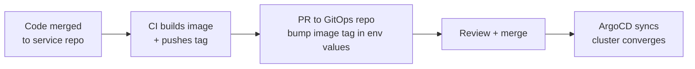

# Deployment & GitOps

Production deployments of the Data Exchange are **declarative**: a Git repository describes every environment, and **ArgoCD** continuously reconciles the clusters to match it. Nothing is deployed by hand.

## The model

- **One chart per service**, one values file per environment. Each service's Helm chart packages its Deployment, Service, config, network policies, and probes (`/healthz/live`, `/healthz/ready`).
- **ApplicationSets** generate an ArgoCD Application per service per environment from a simple list — adding a service to an environment is adding an entry, not writing YAML by hand.
- **Environments are directories** (`dev` → `staging` → `production`), differing only in values: replica counts, resource limits, hostnames, and secret references.
- **Secrets never live in Git** — the cluster's External Secrets Operator resolves references into environment variables at deploy time (see [Configuration](../develop/configuration.md)).

## The promotion workflow

Promotion from staging to production is a pull request that changes an image tag — reviewable, auditable, and revertible like any other change. Rollback is `git revert`.

## Deployment topologies

The same charts deploy both shapes described in [Deployment Architecture](../technical/deployment.md):

- **Central** — all services in one cluster behind one gateway.
- **Federated** — a data-plane bundle (gateway + data services + local authorization replica) deployed into a provider's cluster, configured to trust the central identity provider and consume the central policy-event stream.

## Operational guardrails

- ArgoCD reports **drift** — any manual change to a cluster shows as out-of-sync and is reverted on the next sync.
- Deploys gate on **readiness**: a service that fails `/healthz/ready` never receives traffic, and a bad rollout self-arrests.
- Run the platform smoke test against staging after every promotion — see [Testing](../develop/testing.md).

For what to watch after deployment, see [Monitoring & Health](./monitoring.md).
