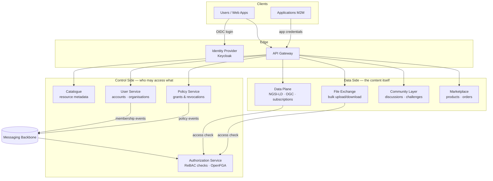

# System Architecture

The Data Exchange is a **cloud-native, microservices-based platform**. Deciding *who may access what* is handled by the control-side components (catalogue, user, policy, authorization), while the data-side components (data plane, file exchange) serve the actual content once access is proven. Every request enters through a single **API Gateway**.

## System diagram

## Design principles

1. **Single entry point** — every request enters through the API Gateway, which authenticates it once and propagates a **cryptographically signed identity** (HMAC-signed headers) to all internal services. Internal services never re-validate user credentials.

2. **Policy as the source of truth** — access grants live in the Policy Service as explicit, auditable records (who granted what, to whom, until when). The Authorization Service holds a *projection* of those grants optimised for millisecond permission checks.

3. **Asynchronous synchronisation** — when a policy is created or revoked, the change is propagated to the Authorization Service through the messaging backbone using a **transactional outbox**, so the two can never silently diverge: a committed grant is always eventually enforced.

4. **Control/data separation** — components that decide access never sit in the hot path of serving data. The Data Plane asks one fast question ("may this subject do this action on this resource?") and streams the content itself.

5. **Unbundled and independently deployable** — each capability is its own service communicating only through well-defined contracts (REST, gRPC, events), so services scale and evolve independently.

## The service fleet

| Service | Role | Plane |
| --- | --- | --- |
| [API Gateway](../components/api-gateway.md) | Edge — JWT validation, authorization enforcement, signed identity, routing | Edge |
| [Identity Provider](../components/identity-provider.md) (Keycloak) | User and machine identity (OIDC) | Edge |
| [Authorization Service](../components/authorization-service.md) | Decision point — real-time ReBAC checks (OpenFGA) | Control |
| [Policy Service](../components/policy-service.md) | System of record for access grants | Control |
| [User Service](../components/user-service.md) | Profiles, organisations, membership, delegations, app credentials | Control |
| [Catalogue](../components/catalogue.md) | Registry and discovery of resources (JSON-LD, search) | Control |
| [Data Plane](../components/data-plane.md) | NGSI-LD queries, OGC API Features, subscriptions | Data |
| [File Exchange](../components/file-exchange.md) | Bulk file upload/download with object storage | Data |
| [Community Layer](../components/community-layer.md) | Discussions and data challenges | Data |
| [Marketplace](../components/marketplace.md) | Monetisable datasets — products, orders, payments | Data |
| [Supporting services](../components/supporting-services.md) | Registry, credits, audit, notifications | Control |
| [Messaging Backbone](../components/messaging-backbone.md) (RabbitMQ) | Asynchronous events connecting the components | Both |

## Component interactions

| From → To | Channel | Purpose |
| --- | --- | --- |
| Gateway → all services | HTTP + signed identity headers | Forward authenticated requests |
| Gateway / services → User service | gRPC | Verify app credentials, resolve delegations |
| Policy Service → Catalogue | gRPC | Validate the resource being granted (owner, organisation, allowed access types) |
| Policy / User service → Authorization Service | Events (messaging backbone) | Project grants, revocations, and membership changes into the authorization graph |
| Data Plane / File Exchange → Authorization Service | HTTP `/v1/check` | Real-time permission checks before serving data |
| Any service → Notification service | Events | Outbound email to users |
| Any mutating endpoint → Audit service | Events | Immutable audit trail |

## Every service, the same shape

Each service follows a common skeleton and exposes the same operational surface:

- `GET /healthz/live` — liveness · `GET /healthz/ready` — readiness (real dependency checks)
- `GET /metrics` — Prometheus metrics
- `GET /docs` — embedded Swagger UI (the OpenAPI spec is compiled into the binary)

Configuration is environment-driven with baked development defaults — see [Configuration](../develop/configuration.md). Responses follow the platform-wide envelope — see [API Standards](../develop/api-standards.md).

## Shared infrastructure

All components run as containers behind the gateway. Shared infrastructure: **PostgreSQL** (policies, accounts, service data), **Elasticsearch** (catalogue discovery and NGSI-LD search), an **S3-compatible object store** (file exchange), **Redis** (caching), and **RabbitMQ** (the messaging backbone). Identity is delegated entirely to **Keycloak**.

:::tip Deployment shapes
The same images support a **central** topology (everything in one cluster) and a **federated** topology (a data plane inside each provider's network, connected to the central control plane). See [Deployment Architecture](./deployment.md).
:::
