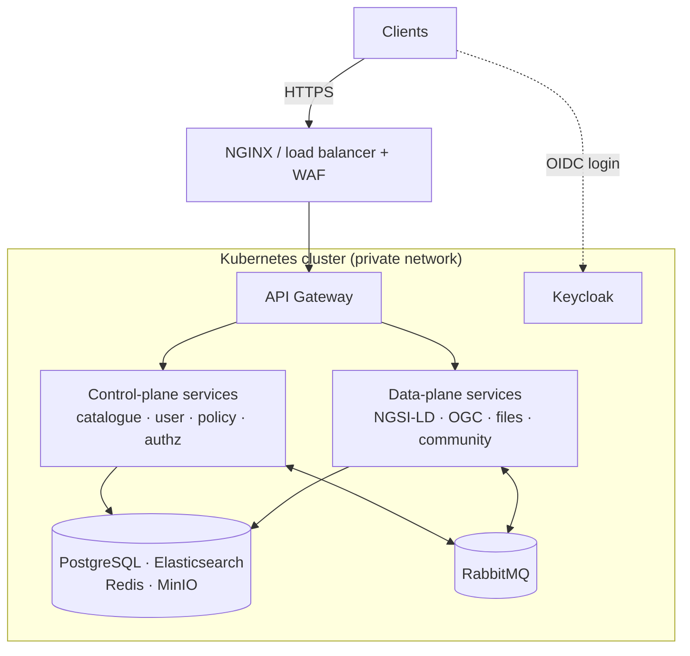

# Deployment Architecture

All platform components run as containers behind the API Gateway. The same container images support two deployment configurations, selected purely by which services a deployment includes — nothing is forked.

## Central topology

Everything behind one gateway in one Kubernetes cluster — suitable for a single-organization exchange or a state/national deployment operated by one team.

## Federated topology

A **data plane + its own gateway run inside a provider's network** (a federated edge) and connect to the central control plane for:

- **Identity** — cached signing keys (JWKS) from the central identity provider.
- **Policy** — a local authorization-service replica fed by the central policy-event stream.

Data never leaves the provider network; only tokens and policy tuples cross the boundary. This lets multiple independently operated data planes — including third-party ones — coexist in a single exchange, avoiding central data bottlenecks.

## Network zones

- **Public zone** — external users connect over HTTPS through a load balancer / WAF; the only application entry point is the API Gateway. Large file downloads go directly to object storage via short-lived presigned URLs.
- **Private zone** — all services, data stores, and the message broker live on a private network, unreachable from outside. Service-to-service traffic carries the gateway-signed identity.
- **Operations** — metrics, logs, and dashboards (Prometheus/Grafana/Loki) with alerting; regular backups of data stores and configuration for disaster recovery.

## Environments and promotion

Production deployments are managed declaratively with **GitOps** (ArgoCD): each environment (dev → staging → production) is a directory of Helm values in a Git repository, and promotion is a pull request. See [Deployment & GitOps](../operations/deployment-gitops.md) for the workflow and [Security](../operations/security.md) for the hardening checklist.

## Local development

The entire platform — every service plus all infrastructure — runs locally with Docker Compose in a few commands. See [Local Development](../develop/local-development.md).
